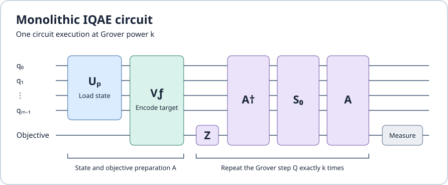
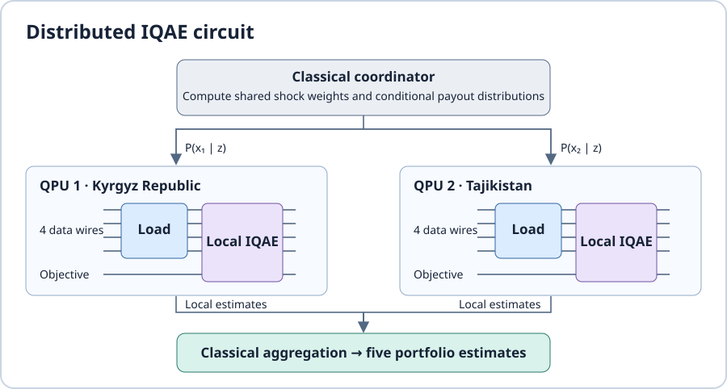

# AngelQ-ADB Quantum Challenge Submission — Efficient Quantum Amplitude Estimation for Joint Catastrophe-Bond Risk
This Phase 1 prototype reproduces Table 5 of the challenge brief for the two-country portfolio. It compares exact classical computation, four classical samplers, and noiseless IQAE simulations. The experiments extend the portfolio to 3, 5, and 10 countries by alternating Kyrgyz-like and Tajik-like parameters. The exact solver and the circuits both use conditional independence given shared earthquake and rainfall events.

## Setup

Run the commands below from the repository root with Python 3.12.

```bash
python -m venv .venv
source .venv/bin/activate
python -m pip install -r requirements.txt
python -m pytest
```

On Windows PowerShell, activate with `.venv\Scripts\Activate.ps1`.

## Run the estimators

### Classical reference and sampling

```bash
python -m classical
python -m classical --scenario adb-rain-stress --n 131072
```

Both commands print the exact Table 5 values for all five scenarios, then estimates from Monte Carlo, scrambled Sobol, stratified, and importance sampling. Each estimate includes a 95% confidence half-width and relative error. The first run samples the base scenario with 65,536 paths per method. The second samples the rain-stress scenario with 131,072 paths per method.

### Monolithic IQAE

```bash
python -m quantum --n 2
python -m quantum --n 2 --backend lightning.qubit --target all_pay --eps 0.05
```

Here `--n` sets the number of countries. The default `oracle` backend draws shots from ideal circuit probabilities. For up to three countries, use `lightning.qubit` or `default.qubit` to simulate the PennyLane circuit. Add `--shots-mode` for finite-shot circuit execution. `--eps` sets the target relative confidence-interval half-width, so `0.05` requests ±5%. The first command prints results for all five targets. The second reports only the probability that both bonds pay, whose exact base-case value is about 4.41%. Each result includes the estimate, confidence interval, oracle calls, shots, and circuit size.



### Distributed IQAE

```bash
python -m quantum.distributed_iqae --capacities 5 6
python -m quantum.distributed_iqae --countries 3 --groups 0,1 2
```

Each country group runs its own local circuits, and a classical coordinator combines the results. Groups use zero-based country indices. Lightning is the default simulator. Pass `--device default.qubit` to switch. Both commands print JSON with all five estimates, their intervals, per-group resource counts, and timings. The first assigns one country to each of two simulated processors. The second assigns countries 0 and 1 to one processor and country 2 to the other.



## Regenerate the plots

```bash
python -m benchmarks.benchmark --quick --workers 4
python -m benchmarks.exact_scaling
```

Omit `--quick` for the full benchmark with more replications. The first command prints benchmark progress and saves nine PNGs comparing estimation accuracy, circuit costs, and runtimes. The second prints solver timings and rare-event costs, and saves `exact_scaling.png` and `exhaustion_cost.png`. All plots go to [results/figures](results/figures/). Start with [accuracy by computational work](results/figures/iqae_accuracy.png), [IQAE cost advantage](results/figures/iqae_advantage.png), [distributed runtime](results/figures/distributed_runtime.png), and [exact solver scaling](results/figures/exact_scaling.png).

The five targets are expected loss, the probability all bonds pay, the probability loss exceeds the threshold, expected excess loss above the threshold (stop-loss), and the probability all bonds are exhausted. The advantage plot divides classical paths by IQAE oracle calls at the same relative RMSE. The runtime plots give a separate comparison in seconds, using modeled quantum runtimes.

## AI use

AI assisted with the code.
